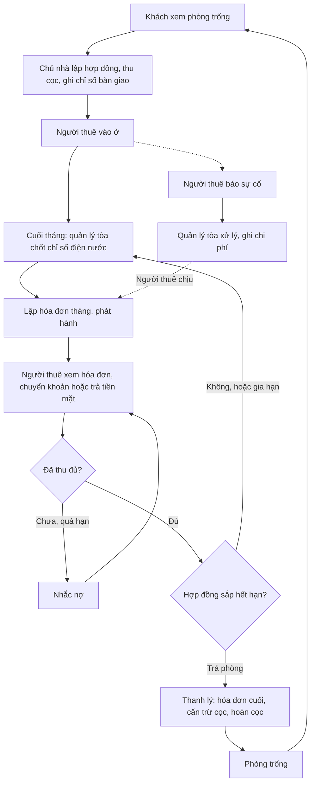
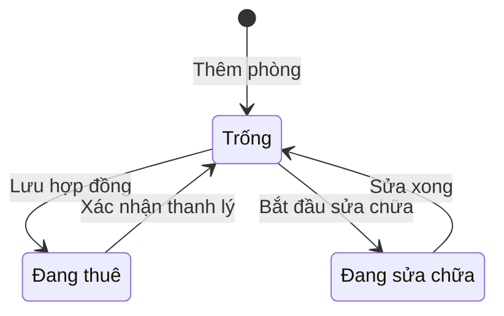
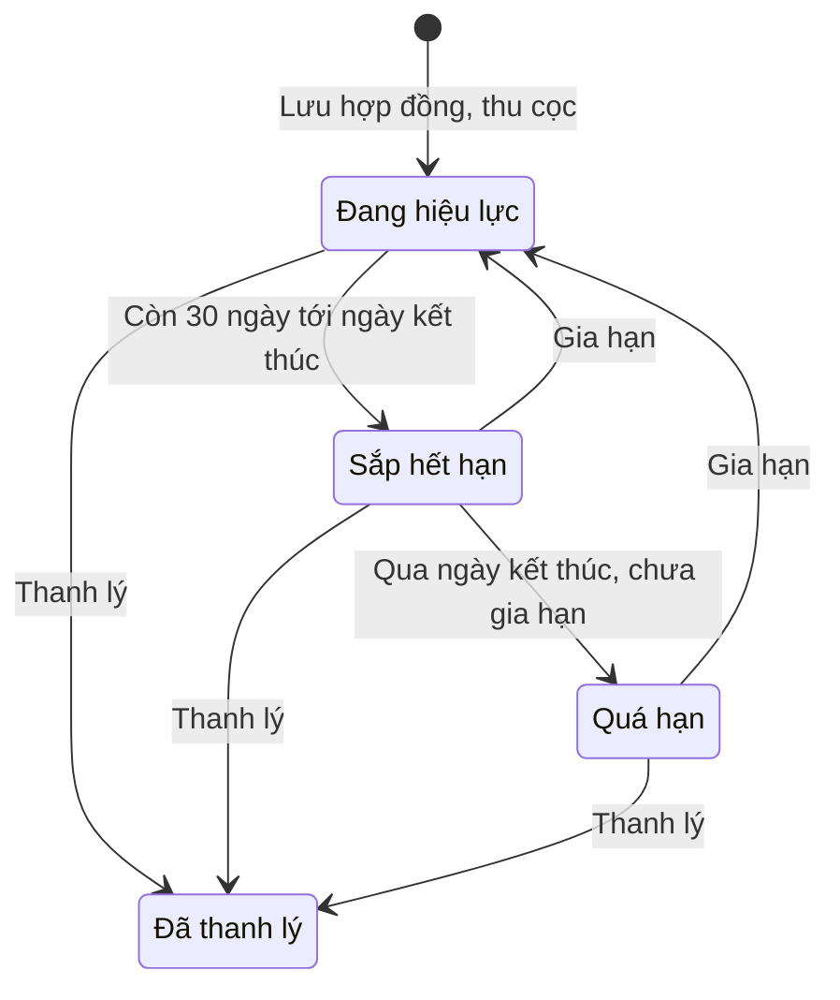
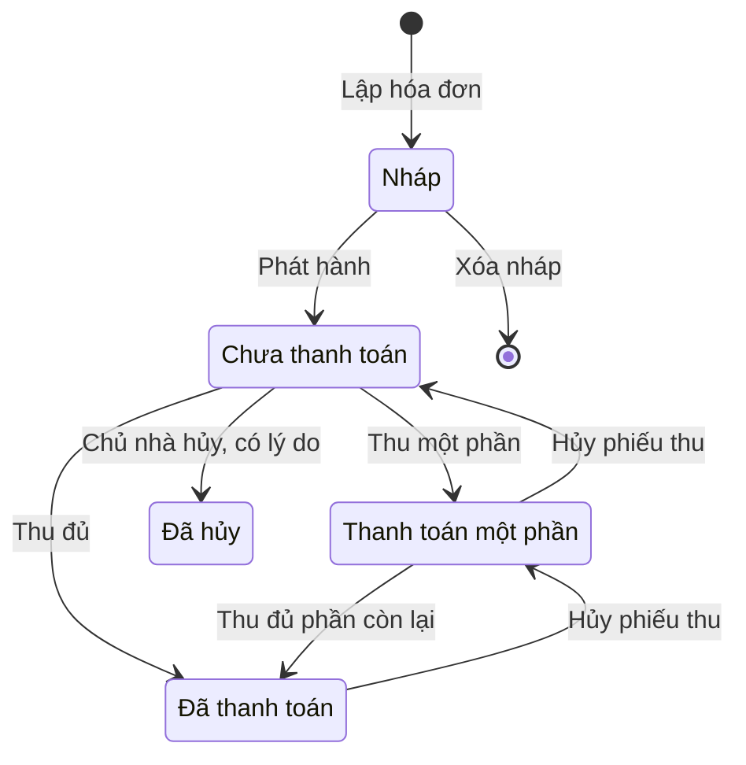
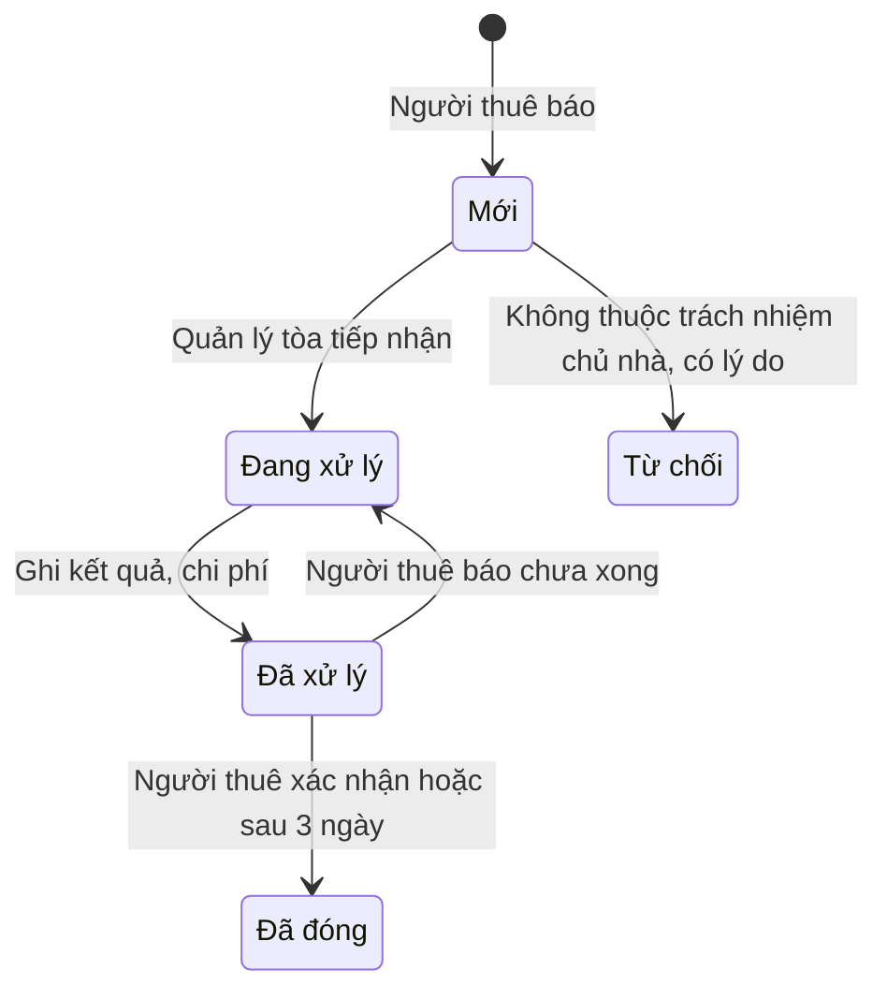

# Đặc tả yêu cầu phần mềm (SRS) — Quản lý Nhà trọ

| Phiên bản | Ngày | Trạng thái |
| :--- | :--- | :--- |
| 1.0 | 12/10/2026 | Bản nháp để triển khai demo |

> Cách viết, quy ước mã, mức độ chi tiết: `ZDOCS/05-HUONG-DAN/HUONG-DAN-VIET-TAI-LIEU-NGHIEP-VU.md`.
> Phần nền (đăng nhập, tài khoản, vai trò, cài đặt, đặt lại dữ liệu demo): `ZDOCS/03-KIEN-TRUC/USE-CASE-NEN.md`, không viết lại ở đây.

---

## 1. Giới thiệu

### 1.1. Mục đích

Tài liệu mô tả đầy đủ yêu cầu của bản demo Quản lý Nhà trọ: chức năng, quy tắc tính tiền phòng, điện nước, tiền cọc, công nợ, dữ liệu, báo cáo, phân quyền và màn hình. Dev dùng để code, tester dùng để viết và chạy test case, sales dùng để biết demo làm được gì.

### 1.2. Phạm vi

**Trong phạm vi:** tòa nhà và bảng giá điện nước, dịch vụ; phòng và sơ đồ phòng; người thuê; hợp đồng, tiền cọc, gia hạn, thanh lý; chốt chỉ số điện nước; lập và phát hành hóa đơn tháng; thu tiền, công nợ; nhắc nợ và nhắc hợp đồng sắp hết hạn; trang người thuê trên điện thoại; báo và xử lý sự cố; báo cáo doanh thu, tỉ lệ lấp đầy.

**Ngoài phạm vi:** cổng thanh toán và tự gạch nợ qua ngân hàng (QR chỉ hiển thị, người thu xác nhận), gửi Zalo, SMS thật (giả lập), công tơ điện tử đọc từ xa, khai báo tạm trú với cơ quan công an, hóa đơn điện tử và kê khai thuế cho thuê nhà, phí phạt trả chậm, đăng tin cho thuê, quản lý nhiều chủ nhà trên một hệ thống.

### 1.3. Thuật ngữ

| Thuật ngữ | Giải thích |
| :--- | :--- |
| Tòa nhà | Một khu trọ hoặc tòa căn hộ dịch vụ, có bảng giá điện nước, dịch vụ và quản lý tòa riêng |
| Phòng | Đơn vị cho thuê trong một tòa nhà |
| Giá niêm yết | Giá thuê công bố của phòng, dùng làm mặc định khi lập hợp đồng |
| Người thuê | Người ở trong phòng; người thuê đại diện là người đứng tên hợp đồng |
| Người ở cùng | Người ở chung phòng, có tên trong hợp đồng, tính vào số người ở |
| Hợp đồng | Hợp đồng thuê phòng giữa chủ nhà và người thuê đại diện |
| Tiền cọc | Khoản người thuê đặt khi ký hợp đồng để bảo đảm; là tiền giữ hộ, không phải doanh thu |
| Kỳ | Tháng dương lịch dùng để tính tiền, vd kỳ 10/2026 |
| Chỉ số | Số đọc trên công tơ điện hoặc đồng hồ nước |
| Chỉ số bàn giao | Chỉ số lúc người thuê nhận phòng |
| Chốt chỉ số | Ghi chỉ số mới của phòng cho một kỳ |
| Tiêu thụ | Chỉ số mới trừ chỉ số cũ |
| Dịch vụ | Khoản thu cố định hằng tháng: internet, rác, gửi xe, vệ sinh chung |
| Khoản phát sinh | Khoản thu thêm một lần, vd sửa chữa do người thuê làm hỏng |
| Hóa đơn tháng | Hóa đơn của một hợp đồng cho một kỳ |
| Hóa đơn thanh lý | Hóa đơn cuối cùng khi trả phòng, tính tới ngày trả phòng |
| Phát hành | Chuyển hóa đơn nháp thành hóa đơn chính thức, người thuê thấy được |
| Phiếu thu | Chứng từ ghi nhận tiền thu từ người thuê (tiền thuê hoặc tiền cọc) |
| Phiếu chi | Chứng từ ghi nhận tiền trả lại người thuê (hoàn cọc) |
| Công nợ | Tổng số tiền còn phải thu của các hóa đơn đã phát hành |
| Cấn trừ cọc | Dùng tiền cọc để trả hóa đơn thanh lý và nợ cũ |
| Mất cọc | Người thuê không được hoàn cọc do trả phòng trước hạn mà không báo trước đủ số ngày |
| Thanh lý | Kết thúc hợp đồng: chốt chỉ số cuối, lập hóa đơn thanh lý, xử lý tiền cọc |
| Tỉ lệ lấp đầy | Tỉ lệ phòng đang thuê trên số phòng đang kinh doanh |
| Sự cố | Hỏng hóc người thuê báo: điện, nước, internet, khóa, thiết bị |

### 1.4. Tài liệu liên quan

| Tài liệu | Nội dung |
| :--- | :--- |
| `01-TONG-QUAN-NGHIEP-VU.md` | Tổng quan nghiệp vụ |
| `03-USE-CASE.md` | Đặc tả use case |
| `05-KICH-BAN-KIEM-THU.md` | Test case nghiệm thu |
| `ZDOCS/03-KIEN-TRUC/USE-CASE-NEN.md` | Phần nền dùng chung |

---

## 2. Mô tả tổng quan

### 2.1. Bối cảnh sản phẩm

Chủ nhà có 1–5 khu trọ hoặc tòa căn hộ dịch vụ, tổng 10–200 phòng. Mỗi tòa có một quản lý tòa (thường là người nhà hoặc nhân viên ở tại chỗ) đi ghi điện nước, thu tiền, xử lý hỏng hóc bằng điện thoại. Chủ nhà ký hợp đồng, theo dõi doanh thu, công nợ trên máy tính. Người thuê là sinh viên, người đi làm, dùng điện thoại xem hóa đơn và chuyển khoản. Bản demo có 2 tòa, 40 phòng.

### 2.2. Tác nhân

| Mã vai trò | Tên | Thiết bị | Mục tiêu khi dùng hệ thống |
| :--- | :--- | :--- | :--- |
| `ADMIN` | Quản trị viên | Desktop | Cấu hình hệ thống, tài khoản, phân quyền |
| `MANAGER` | Chủ nhà | Desktop | Phòng, giá, hợp đồng, tiền cọc, xem doanh thu và công nợ, không bỏ sót hợp đồng sắp hết hạn |
| `STAFF` | Quản lý tòa | Điện thoại | Chốt điện nước nhanh, lập hóa đơn, thu tiền, xử lý sự cố của tòa được giao |
| `TENANT` | Người thuê | Điện thoại | Xem hóa đơn rõ ràng, chuyển khoản đúng số tiền, báo sự cố |

Tài khoản demo: `admin`, `quanly` (Chủ nhà), `nhanvien` (Quản lý tòa Bình An), `nguoithue` (người thuê phòng A203).

### 2.3. Quy trình nghiệp vụ

### 2.4. Giả định và ràng buộc

- Kỳ thu tiền theo tháng dương lịch, thu sau: hóa đơn kỳ M gồm tiền phòng, dịch vụ, điện nước của tháng M, lập cuối tháng M hoặc đầu tháng M+1. Thu trước tiền phòng là tùy chọn khi triển khai.
- Mỗi phòng có công tơ điện riêng; đồng hồ nước riêng nếu tòa tính nước theo đồng hồ.
- Đơn giá điện, nước do chủ nhà cấu hình. Khi triển khai cần lưu ý quy định hiện hành về giá bán điện, nước cho người thuê nhà để ở.
- Mã QR chuyển khoản là ảnh giả lập theo định dạng VietQR; hệ thống không kiểm tra tiền đã về. Gửi Zalo, SMS là giả lập.
- Khai báo tạm trú làm ngoài hệ thống; hệ thống chỉ ghi nhận đã đăng ký hay chưa.
- Tiền thuê, dịch vụ, tiền cọc là bội số của 1.000 ₫; đơn giá điện, nước là bội số của 100 ₫.

---

## 3. Yêu cầu chức năng

### 3.1. Tổng quan

| Mã | Yêu cầu | Ưu tiên | Vai trò | UC |
| :--- | :--- | :---: | :--- | :--- |
| FR-01 | Hệ thống hiển thị số phòng theo trạng thái, tỉ lệ lấp đầy, tổng tiền hóa đơn kỳ này, đã thu, còn nợ, số hóa đơn quá hạn; quản lý tòa chỉ thấy tòa được giao | P1 | MANAGER, STAFF | UC-14 |
| FR-02 | Tổng quan có danh sách việc cần làm: phòng chưa chốt điện nước kỳ này, hợp đồng hết hạn trong 30 ngày, hóa đơn quá hạn, sự cố đang mở, báo chuyển khoản chờ xác nhận; bấm để mở chi tiết | P1 | MANAGER, STAFF | UC-14 |
| FR-03 | Người thuê đăng nhập thấy trang của mình: phòng, ngày hết hạn hợp đồng, tiền cọc, hóa đơn chưa thanh toán kèm nút xem QR, lịch sử thanh toán, thông báo nhắc nợ, nút báo sự cố | P1 | TENANT | UC-12 |

### 3.2. Tòa nhà và phòng

| Mã | Yêu cầu | Ưu tiên | Vai trò | UC |
| :--- | :--- | :---: | :--- | :--- |
| FR-04 | Hệ thống cho phép chủ nhà thêm, sửa tòa nhà: mã, tên, địa chỉ, số tầng, quản lý tòa phụ trách, ngày hạn thanh toán, ngân hàng và số tài khoản nhận tiền | P1 | MANAGER | UC-01 |
| FR-05 | Chủ nhà cấu hình bảng giá theo tòa có kỳ hiệu lực: đơn giá điện, cách tính nước (theo đồng hồ hoặc theo người) và đơn giá, danh sách dịch vụ với đơn vị tính (phòng, người, xe) và đơn giá | P1 | MANAGER | UC-01 |
| FR-06 | Hệ thống cho phép chủ nhà thêm, sửa phòng: mã, tòa, tầng, diện tích, giá niêm yết, số người tối đa, tiện nghi (máy lạnh, nóng lạnh, gác lửng, ban công), ảnh | P1 | MANAGER | UC-02 |
| FR-07 | Sơ đồ phòng theo tòa và tầng, màu theo trạng thái (trống, đang thuê, đang sửa chữa) và cờ nợ quá hạn; lọc theo tòa, trạng thái, khoảng giá; bấm phòng mở chi tiết | P1 | MANAGER, STAFF | UC-02 |
| FR-08 | Chủ nhà, quản lý tòa chuyển phòng trống sang đang sửa chữa và ngược lại | P2 | MANAGER, STAFF | UC-02 |

### 3.3. Người thuê và hợp đồng

| Mã | Yêu cầu | Ưu tiên | Vai trò | UC |
| :--- | :--- | :---: | :--- | :--- |
| FR-09 | Hệ thống cho phép thêm, sửa người thuê: họ tên, số điện thoại, CCCD, ngày sinh, địa chỉ thường trú, nghề nghiệp hoặc nơi làm việc, biển số xe, ảnh CCCD hai mặt, đã đăng ký tạm trú hay chưa | P1 | MANAGER, STAFF | UC-03 |
| FR-10 | Chủ nhà tạo hợp đồng cho phòng trống: người thuê đại diện, người ở cùng, ngày bắt đầu, thời hạn, giá thuê, tiền cọc, dịch vụ đăng ký và số xe, chỉ số điện nước bàn giao, ghi chú điều khoản | P1 | MANAGER | UC-04 |
| FR-11 | Khi lưu hợp đồng, hệ thống tạo phiếu thu tiền cọc và chuyển phòng sang đang thuê | P1 | MANAGER | UC-04 |
| FR-12 | Chủ nhà in hợp đồng theo mẫu với thông tin điền sẵn, in qua trình duyệt khổ A4 | P2 | MANAGER | UC-04 |
| FR-13 | Chủ nhà gia hạn hợp đồng: số tháng gia hạn, giá thuê mới áp dụng từ kỳ chọn; hệ thống lưu lịch sử gia hạn | P2 | MANAGER | UC-05 |
| FR-14 | Chủ nhà thanh lý hợp đồng: ngày báo trả phòng, ngày trả phòng, chỉ số điện nước cuối, khoản khấu trừ hư hỏng; hệ thống lập hóa đơn thanh lý, tính mất cọc, cấn trừ cọc, số tiền hoàn hoặc còn phải thu | P1 | MANAGER | UC-06 |
| FR-15 | Chủ nhà tạo tài khoản đăng nhập vai trò `TENANT` cho người thuê đại diện, tên đăng nhập là số điện thoại | P2 | MANAGER | UC-03 |

### 3.4. Điện nước

| Mã | Yêu cầu | Ưu tiên | Vai trò | UC |
| :--- | :--- | :---: | :--- | :--- |
| FR-16 | Quản lý tòa chốt chỉ số theo kỳ trên điện thoại: chọn tòa và kỳ, danh sách phòng đang thuê, nhập chỉ số mới, thấy chỉ số cũ và tiêu thụ ngay, chuyển phòng kế bằng nút "Tiếp"; thanh tiến độ số phòng đã chốt | P1 | STAFF, MANAGER | UC-07 |
| FR-17 | Quản lý tòa chụp hoặc tải ảnh công tơ kèm chỉ số | P2 | STAFF | UC-07 |
| FR-18 | Hệ thống cảnh báo tiêu thụ bất thường theo BR-10 và yêu cầu xác nhận trước khi lưu | P2 | STAFF, MANAGER | UC-07 |
| FR-19 | Ghi nhận thay công tơ giữa kỳ: chỉ số cuối công tơ cũ, chỉ số đầu công tơ mới | P3 | STAFF | UC-07 |

### 3.5. Hóa đơn

| Mã | Yêu cầu | Ưu tiên | Vai trò | UC |
| :--- | :--- | :---: | :--- | :--- |
| FR-20 | Hệ thống lập hóa đơn hàng loạt theo tòa và kỳ cho các hợp đồng hiệu lực trong kỳ; báo các phòng bị bỏ qua kèm lý do (chưa chốt chỉ số, đã có hóa đơn) | P1 | MANAGER, STAFF | UC-08 |
| FR-21 | Hóa đơn gồm các dòng tiền phòng (số ngày ở nếu không đủ tháng), điện (chỉ số cũ, mới, tiêu thụ, đơn giá), nước, từng dịch vụ, khoản phát sinh, giảm trừ; hiển thị nợ các kỳ trước và tổng cần thanh toán | P1 | MANAGER, STAFF | UC-08 |
| FR-22 | Hệ thống cho phép thêm, xóa khoản phát sinh hoặc giảm trừ có ghi chú trên hóa đơn nháp, và xóa hóa đơn nháp | P1 | MANAGER, STAFF | UC-08 |
| FR-23 | Phát hành hóa đơn từng cái hoặc hàng loạt; hóa đơn phát hành hiện ở trang người thuê kèm mã QR chuyển khoản theo BR-19 | P1 | MANAGER, STAFF | UC-08, UC-12 |
| FR-24 | Chủ nhà hủy hóa đơn đã phát hành chưa có thanh toán, bắt buộc lý do | P2 | MANAGER | UC-08 |
| FR-25 | In hóa đơn hoặc sao chép nội dung tóm tắt và đường dẫn hóa đơn để gửi qua Zalo (giả lập) | P2 | MANAGER, STAFF | UC-08 |

### 3.6. Thu tiền và công nợ

| Mã | Yêu cầu | Ưu tiên | Vai trò | UC |
| :--- | :--- | :---: | :--- | :--- |
| FR-26 | Quản lý tòa, chủ nhà ghi nhận thu tiền cho một phòng: phương thức (tiền mặt, chuyển khoản), số tiền, ngày thu, ghi chú; hệ thống phân bổ vào hóa đơn theo BR-20 và in phiếu thu | P1 | STAFF, MANAGER | UC-09 |
| FR-27 | Người thuê bấm "Tôi đã chuyển khoản" kèm số tiền và ảnh biên lai; quản lý tòa xác nhận để tạo phiếu thu hoặc từ chối có lý do | P2 | TENANT, STAFF | UC-09, UC-12 |
| FR-28 | Chủ nhà hủy phiếu thu có lý do; hóa đơn liên quan trở về trạng thái nợ tương ứng | P2 | MANAGER | UC-09 |
| FR-29 | Danh sách công nợ theo phòng: tổng nợ, số hóa đơn nợ, số ngày quá hạn lâu nhất, nhóm tuổi nợ; lọc theo tòa, nhóm tuổi nợ | P1 | MANAGER, STAFF | UC-10 |
| FR-30 | Theo dõi tiền cọc đang giữ theo hợp đồng: thu, cấn trừ, mất cọc, hoàn; tổng cọc đang giữ theo tòa | P2 | MANAGER | UC-10 |

### 3.7. Nhắc nợ và hợp đồng sắp hết hạn

| Mã | Yêu cầu | Ưu tiên | Vai trò | UC |
| :--- | :--- | :---: | :--- | :--- |
| FR-31 | Màn nhắc việc liệt kê hóa đơn sắp tới hạn (2 ngày), hóa đơn quá hạn, hợp đồng hết hạn trong 30 ngày, hợp đồng quá hạn | P2 | MANAGER, STAFF | UC-11 |
| FR-32 | Gửi nhắc nợ cho một hoặc nhiều phòng (giả lập Zalo, SMS): nội dung theo mẫu tự điền, sửa được trước khi gửi; lưu lịch sử; hiện thông báo ở trang người thuê | P2 | MANAGER, STAFF | UC-11 |
| FR-33 | Hệ thống tự tạo nhắc nợ theo lịch: trước hạn 2 ngày, sau hạn 3 ngày và 7 ngày (giả lập) | P3 | Hệ thống | UC-11 |

### 3.8. Sự cố

| Mã | Yêu cầu | Ưu tiên | Vai trò | UC |
| :--- | :--- | :---: | :--- | :--- |
| FR-34 | Người thuê báo sự cố: loại (điện, nước, internet, khóa cửa, thiết bị, khác), mô tả, ảnh, mức khẩn cấp; theo dõi trạng thái và xác nhận đã xử lý | P2 | TENANT | UC-13 |
| FR-35 | Quản lý tòa tiếp nhận, cập nhật trạng thái, ghi kết quả, chi phí và bên chịu chi phí; chi phí người thuê chịu tự thành khoản phát sinh của hóa đơn kế tiếp | P2 | STAFF, MANAGER | UC-13 |

### 3.9. Báo cáo

| Mã | Yêu cầu | Ưu tiên | Vai trò | UC |
| :--- | :--- | :---: | :--- | :--- |
| FR-36 | Báo cáo doanh thu theo kỳ: tiền phòng, điện, nước, dịch vụ, phát sinh, mất cọc; so với thực thu; theo tòa | P2 | MANAGER | UC-15 |
| FR-37 | Báo cáo tỉ lệ lấp đầy theo tháng và theo tòa, số ngày trống trung bình của phòng | P2 | MANAGER | UC-15 |
| FR-38 | Báo cáo điện nước tiêu thụ theo phòng, theo kỳ | P3 | MANAGER | UC-15 |
| FR-39 | Xuất báo cáo đang xem ra file Excel | P3 | MANAGER | UC-15 |

---

## 4. Quy tắc nghiệp vụ

### 4.1. Tòa nhà, phòng, bảng giá

| Mã | Quy tắc | Áp dụng cho |
| :--- | :--- | :--- |
| BR-01 | Mã tòa 2–5 chữ in hoa (`BA`, `HS`). Mã phòng 2–10 chữ in hoa và số, duy nhất toàn hệ thống (`A203`). Diện tích lớn hơn 0; số người tối đa từ 1 đến 10; giá niêm yết là bội số của 1.000 ₫ | FR-04, FR-06 |
| BR-02 | Trạng thái phòng: Trống → Đang thuê khi lưu hợp đồng; Đang thuê → Trống khi xác nhận thanh lý; Trống ↔ Đang sửa chữa do chủ nhà hoặc quản lý tòa chuyển. Không chuyển phòng Đang thuê sang Đang sửa chữa; chỉ lập hợp đồng cho phòng Trống; không xóa phòng đã từng có hợp đồng | FR-06, FR-08, FR-10 |
| BR-03 | Bảng giá theo tòa có kỳ hiệu lực; hóa đơn kỳ M dùng bảng giá có kỳ hiệu lực gần nhất không sau M. Không sửa bảng giá đã dùng cho hóa đơn phát hành, muốn đổi giá thì tạo bảng giá mới từ kỳ sau. Đơn vị tính dịch vụ: theo phòng, theo người, theo xe. Mẫu tòa Bình An: điện 3.500 ₫/kWh, nước 20.000 ₫/m³ theo đồng hồ, Internet 100.000 ₫/phòng, rác 20.000 ₫/phòng, gửi xe 100.000 ₫/xe. Mẫu tòa Hoa Sen: điện 3.800 ₫/kWh, nước 100.000 ₫/người, dịch vụ chung 150.000 ₫/phòng, gửi xe 120.000 ₫/xe | FR-05 |

### 4.2. Người thuê và hợp đồng

| Mã | Quy tắc | Áp dụng cho |
| :--- | :--- | :--- |
| BR-04 | CCCD đúng 12 chữ số, không trùng; số điện thoại 10 chữ số bắt đầu bằng 0, không trùng (dùng làm tên đăng nhập khi tạo tài khoản). Không xóa người thuê đang có tên trong hợp đồng chưa thanh lý | FR-09, FR-15 |
| BR-05 | Một phòng có tối đa một hợp đồng chưa thanh lý. Số người ở (đại diện + người ở cùng) từ 1 đến số người tối đa của phòng. Thời hạn 1–24 tháng; ngày kết thúc = ngày bắt đầu + thời hạn − 1 ngày (vd bắt đầu 15/10/2026, 12 tháng → 14/10/2027). Ngày bắt đầu trong khoảng hôm nay ± 30 ngày. Giá thuê mặc định bằng giá niêm yết, sửa được | FR-10 |
| BR-06 | Tiền cọc từ 0 đến 3 tháng tiền thuê (mặc định 1 tháng), bội số 1.000 ₫. Lưu hợp đồng có cọc lớn hơn 0 thì tạo phiếu thu loại "Tiền cọc". Tiền cọc là khoản giữ hộ, không tính doanh thu, theo dõi riêng theo hợp đồng | FR-10, FR-11, FR-30 |
| BR-07 | Gia hạn thêm 1–24 tháng tính từ ngày kết thúc cũ (vd 31/10/2026 gia hạn 12 tháng → 31/10/2027). Giá mới áp dụng từ kỳ chọn, không sớm hơn kỳ chưa có hóa đơn phát hành. Mỗi lần gia hạn lưu ngày kết thúc cũ, mới, giá cũ, mới, người thực hiện | FR-13 |
| BR-08 | Hợp đồng "Sắp hết hạn" khi ngày kết thúc nằm trong 30 ngày tới (tham số); "Quá hạn" khi đã qua ngày kết thúc mà chưa gia hạn hay thanh lý. Hợp đồng quá hạn vẫn được lập hóa đơn tháng theo giá hiện tại | FR-02, FR-31 |

### 4.3. Chỉ số điện nước

| Mã | Quy tắc | Áp dụng cho |
| :--- | :--- | :--- |
| BR-09 | Chỉ số cũ của kỳ = chỉ số mới kỳ trước của phòng; hợp đồng bắt đầu trong kỳ thì chỉ số cũ = chỉ số bàn giao. Chỉ số là số nguyên không âm; chỉ số mới ≥ chỉ số cũ; tiêu thụ = chỉ số mới − chỉ số cũ | FR-16 |
| BR-10 | Tiêu thụ bất thường khi lớn hơn 2 lần trung bình 3 kỳ gần nhất của phòng, hoặc bằng 0 khi phòng đang thuê. Người chốt phải bấm xác nhận mới lưu; chỉ số gắn cờ "Bất thường" | FR-18 |
| BR-11 | Sửa chỉ số đã chốt chỉ khi hóa đơn kỳ đó chưa phát hành (hóa đơn nháp tự tính lại); đã phát hành thì phải hủy hóa đơn trước (BR-18). Thay công tơ giữa kỳ: tiêu thụ = (chỉ số cuối công tơ cũ − chỉ số cũ) + (chỉ số mới − chỉ số đầu công tơ mới) | FR-16, FR-19 |

### 4.4. Hóa đơn

| Mã | Quy tắc | Áp dụng cho |
| :--- | :--- | :--- |
| BR-12 | Kỳ hóa đơn là tháng dương lịch. Số ngày ở trong kỳ tính từ ngày lớn hơn trong hai ngày (đầu kỳ, bắt đầu hợp đồng) tới ngày nhỏ hơn trong hai ngày (cuối kỳ, trả phòng), tính cả hai đầu. Tiền phòng = giá thuê × số ngày ở ÷ số ngày của tháng, làm tròn đến 1.000 ₫ (từ 500 ₫ làm tròn lên); ở đủ tháng thì bằng giá thuê. Vd vào ở 15/10/2026, giá 3.000.000 ₫: 17 ngày, 3.000.000 × 17 ÷ 31 = 1.645.161 → 1.645.000 ₫ | FR-21, FR-14 |
| BR-13 | Tiền điện = tiêu thụ × đơn giá điện. Nước theo đồng hồ = tiêu thụ × đơn giá; nước theo người = đơn giá × số người ở. Dịch vụ theo phòng = đơn giá; theo người = đơn giá × số người ở; theo xe = đơn giá × số xe đăng ký. Nước theo người và mọi dịch vụ tính theo tỉ lệ ngày ở như BR-12, làm tròn từng dòng đến 1.000 ₫ | FR-21 |
| BR-14 | Tổng hóa đơn = tiền phòng + điện + nước + dịch vụ + khoản phát sinh − giảm trừ, không nhỏ hơn 0. Nợ các kỳ trước chỉ hiển thị tham khảo và cộng vào dòng "Tổng cần thanh toán", không cộng vào tổng hóa đơn | FR-21, FR-22 |
| BR-15 | Mỗi hợp đồng có tối đa một hóa đơn tháng cho mỗi kỳ (không tính hóa đơn đã hủy). Chỉ lập khi phòng đã chốt chỉ số điện, và nước nếu tính theo đồng hồ, của kỳ đó. Hợp đồng thanh lý trong kỳ không có hóa đơn tháng mà có hóa đơn thanh lý | FR-20 |
| BR-16 | Hạn thanh toán = ngày N của tháng kế tiếp kỳ (N theo tòa, mẫu 05); phát hành sau ngày đó thì hạn = ngày phát hành + 3 ngày. Vd hóa đơn kỳ 10/2026 có hạn 05/11/2026. Hóa đơn thanh lý có hạn là ngày trả phòng | FR-23 |
| BR-17 | Trạng thái theo số đã thu: chưa thu → "Chưa thanh toán"; đã thu lớn hơn 0 và nhỏ hơn tổng → "Thanh toán một phần"; đã thu bằng tổng → "Đã thanh toán". Quá hạn khi chưa thu đủ và hôm nay sau hạn; số ngày quá hạn = hôm nay − hạn | FR-26, FR-29 |
| BR-18 | Chỉ sửa, xóa hóa đơn "Nháp". Hóa đơn đã phát hành chỉ hủy được khi không còn phiếu thu hiệu lực nào phân bổ vào, bắt buộc lý do; hóa đơn hủy không tính doanh thu và được lập lại cho kỳ đó | FR-22, FR-24 |
| BR-19 | Mã QR chuyển khoản (giả lập VietQR): tài khoản nhận của tòa, số tiền = số còn nợ của hóa đơn, nội dung = mã hóa đơn (vd `HD2610-A203`) | FR-23 |

### 4.5. Thu tiền và công nợ

| Mã | Quy tắc | Áp dụng cho |
| :--- | :--- | :--- |
| BR-20 | Phiếu thu tiền thuê: số tiền lớn hơn 0, không vượt tổng nợ hiện tại của hợp đồng (hoặc số còn nợ của hóa đơn nếu người thu chọn một hóa đơn). Hệ thống phân bổ vào hóa đơn có hạn sớm nhất trước. Vd nợ kỳ 08 còn 1.500.000 ₫, kỳ 09 còn 3.900.000 ₫, thu 3.000.000 ₫ → kỳ 08 đủ, kỳ 09 còn 2.400.000 ₫ | FR-26 |
| BR-21 | Chỉ chủ nhà hủy phiếu thu, bắt buộc lý do; số đã phân bổ trả lại thành nợ của các hóa đơn tương ứng. Phiếu thu tiền cọc chỉ hủy được khi hợp đồng chưa có hóa đơn nào | FR-28 |
| BR-22 | Người thuê báo đã chuyển khoản không làm đổi công nợ. Quản lý tòa xác nhận thì hệ thống tạo phiếu thu chuyển khoản đúng số tiền đã báo, theo BR-20; từ chối phải có lý do, người thuê thấy lý do | FR-27 |
| BR-23 | Tuổi nợ theo hóa đơn quá hạn lâu nhất của hợp đồng: Chưa tới hạn; Quá hạn 1–15 ngày; 16–30 ngày; Trên 30 ngày. Phòng có nợ quá hạn trên 30 ngày có cờ đỏ trên sơ đồ phòng | FR-07, FR-29 |
| BR-24 | Mỗi hợp đồng được nhắc nợ tối đa 1 lần mỗi ngày. Nội dung mẫu: mã phòng, tên tòa, từng hóa đơn còn nợ và số tiền, tổng nợ, hạn gần nhất, thông tin chuyển khoản. Gửi Zalo, SMS là giả lập: hệ thống lưu lịch sử và hiện thông báo ở trang người thuê | FR-32, FR-33 |

### 4.6. Thanh lý và tiền cọc

| Mã | Quy tắc | Áp dụng cho |
| :--- | :--- | :--- |
| BR-25 | Ngày trả phòng không trước ngày bắt đầu hợp đồng và không sau hôm nay + 30 ngày; chỉ số cuối ≥ chỉ số cũ. Hóa đơn thanh lý gồm tiền phòng, dịch vụ từ đầu kỳ (hoặc ngày bắt đầu hợp đồng) tới ngày trả phòng theo BR-12, BR-13, điện nước theo chỉ số cuối, khoản khấu trừ hư hỏng và khoản phát sinh đang chờ. Không thanh lý được khi hóa đơn tháng của kỳ chứa ngày trả phòng đã phát hành; hóa đơn tháng nháp của kỳ đó tự xóa | FR-14 |
| BR-26 | Mất cọc khi trả phòng trước ngày kết thúc hợp đồng và ngày báo trả phòng cách ngày trả phòng dưới 30 ngày (tham số). Số mất cọc = tiền cọc × tỉ lệ (tham số, mặc định 100%), ghi nhận "Thu nhập khác – phạt cọc". Vd báo 12/10/2026, trả 20/10/2026, hợp đồng đến 31/03/2027: mất cọc | FR-14 |
| BR-27 | Cọc được dùng = tiền cọc − số mất cọc; cấn trừ vào hóa đơn thanh lý rồi tới nợ cũ, theo hạn sớm nhất trước. Còn dư thì lập phiếu chi hoàn cọc; thiếu thì người thuê còn nợ phần chênh. Vd cọc 2.800.000 ₫, hóa đơn thanh lý 2.583.000 ₫, không nợ cũ → hoàn 217.000 ₫. Xác nhận thanh lý thì hợp đồng "Đã thanh lý", phòng "Trống"; công nợ còn lại vẫn theo dõi theo hợp đồng | FR-14, FR-30 |

### 4.7. Sự cố, phạm vi dữ liệu, chỉ số báo cáo

| Mã | Quy tắc | Áp dụng cho |
| :--- | :--- | :--- |
| BR-28 | Sự cố "Khẩn cấp" (mất điện, mất nước, rò rỉ lớn, khóa cửa hỏng) phải tiếp nhận trong 2 giờ, "Thường" trong 24 giờ; quá hạn tiếp nhận hiện nhãn đỏ. Sự cố "Đã xử lý" được đóng khi người thuê xác nhận hoặc tự đóng sau 3 ngày. Chi phí người thuê chịu thành khoản phát sinh chờ, tự thêm vào hóa đơn tháng kế tiếp hoặc hóa đơn thanh lý của hợp đồng | FR-34, FR-35 |
| BR-29 | Quản lý tòa chỉ thấy dữ liệu của tòa được phân công. Người thuê chỉ thấy phòng, hợp đồng, hóa đơn đã phát hành, phiếu thu, thông báo, sự cố của hợp đồng mình là đại diện. Tài khoản người thuê tự khóa khi hợp đồng đã thanh lý và hết nợ | FR-01, FR-03 |
| BR-30 | Mã chứng từ theo §5.3 | FR-10, FR-20, FR-26 |
| BR-31 | Tỉ lệ lấp đầy = số phòng đang thuê ÷ (tổng phòng − số phòng đang sửa chữa) × 100%, làm tròn 1 chữ số thập phân (vd 33 ÷ 38 = 86,8%). Doanh thu kỳ = tổng hóa đơn đã phát hành của kỳ, không gồm hóa đơn hủy và tiền cọc, cộng khoản mất cọc. Thực thu = tổng phiếu thu tiền thuê hiệu lực trong khoảng ngày, không gồm tiền cọc | FR-01, FR-36, FR-37 |

---

## 5. Yêu cầu dữ liệu

### 5.1. Thực thể

| Thực thể | Mô tả | Thuộc tính chính | Quan hệ |
| :--- | :--- | :--- | :--- |
| Tòa nhà | Khu trọ hoặc tòa căn hộ | Mã, tên, địa chỉ, số tầng, ngày hạn thanh toán, ngân hàng, số tài khoản, chủ tài khoản | Có nhiều phòng, nhiều bảng giá; do một quản lý tòa phụ trách |
| Bảng giá | Đơn giá theo kỳ | Tòa, hiệu lực từ kỳ, đơn giá điện, cách tính nước, đơn giá nước | Thuộc một tòa; có nhiều dịch vụ |
| Dịch vụ | Khoản thu cố định | Tên, đơn vị tính (phòng, người, xe), đơn giá | Thuộc một bảng giá |
| Phòng | Đơn vị cho thuê | Mã, tầng, diện tích, giá niêm yết, số người tối đa, tiện nghi, ảnh, trạng thái | Thuộc một tòa; có nhiều hợp đồng theo thời gian, nhiều chỉ số |
| Người thuê | Người ở trọ | Họ tên, số điện thoại, CCCD, ngày sinh, địa chỉ thường trú, nghề nghiệp, biển số xe, ảnh CCCD, đã đăng ký tạm trú, ngày đăng ký | Có thể có một tài khoản `TENANT`; tham gia nhiều hợp đồng |
| Hợp đồng | Hợp đồng thuê phòng | Mã, ngày bắt đầu, thời hạn, ngày kết thúc, giá thuê, tiền cọc, số xe, chỉ số điện, nước bàn giao, trạng thái, ngày báo trả phòng, ngày trả phòng, ghi chú | Thuộc một phòng; một người đại diện, nhiều người ở cùng; nhiều hóa đơn, phiếu thu; lịch sử gia hạn |
| Gia hạn | Lịch sử gia hạn | Ngày kết thúc cũ, mới, giá cũ, mới, áp dụng từ kỳ, người thực hiện | Thuộc một hợp đồng |
| Chỉ số | Số đọc công tơ của một kỳ | Phòng, kỳ, loại (điện, nước), chỉ số cũ, chỉ số mới, tiêu thụ, ảnh, cờ bất thường, người chốt, thời điểm | Thuộc một phòng |
| Hóa đơn | Hóa đơn tháng hoặc thanh lý | Mã, kỳ, loại (tháng, thanh lý), ngày phát hành, hạn thanh toán, tổng tiền, đã thu, trạng thái, lý do hủy | Thuộc một hợp đồng; có nhiều dòng |
| Dòng hóa đơn | Một khoản trong hóa đơn | Loại (tiền phòng, điện, nước, dịch vụ, phát sinh, giảm trừ), diễn giải, số lượng, đơn giá, số ngày tính, thành tiền | Thuộc một hóa đơn; lưu giá tại thời điểm lập |
| Khoản phát sinh chờ | Khoản sẽ thêm vào hóa đơn sau | Hợp đồng, diễn giải, số tiền, nguồn (sự cố, nhập tay), đã tính vào hóa đơn nào | Thuộc một hợp đồng |
| Phiếu thu | Tiền thu từ người thuê | Mã, loại (tiền thuê, tiền cọc), phương thức, số tiền, ngày thu, người thu, trạng thái, lý do hủy | Thuộc một hợp đồng; phân bổ vào nhiều hóa đơn |
| Phân bổ thu | Liên kết phiếu thu với hóa đơn | Phiếu thu, hóa đơn, số tiền | — |
| Giao dịch cọc | Biến động tiền cọc | Hợp đồng, loại (thu cọc, cấn trừ, mất cọc, hoàn cọc), số tiền, chứng từ liên quan | Thuộc một hợp đồng |
| Phiếu chi | Tiền trả lại người thuê | Mã, loại (hoàn cọc), số tiền, ngày, người chi | Thuộc một hợp đồng |
| Báo chuyển khoản | Người thuê báo đã chuyển | Hóa đơn, số tiền, ảnh biên lai, trạng thái (chờ xác nhận, đã xác nhận, từ chối), lý do từ chối | Thuộc một hóa đơn; tạo tối đa một phiếu thu |
| Nhắc nợ | Lịch sử nhắc | Hợp đồng, ngày giờ, kênh (Zalo, SMS – giả lập), nội dung, người gửi, tự động hay thủ công | Thuộc một hợp đồng |
| Sự cố | Hỏng hóc người thuê báo | Mã, loại, mô tả, ảnh, mức (thường, khẩn cấp), trạng thái, thời điểm báo, tiếp nhận, xử lý xong, kết quả, chi phí, bên chịu | Thuộc một phòng; do người thuê báo; quản lý tòa xử lý |

Dòng hóa đơn lưu lại đơn giá, giá thuê tại thời điểm lập. Đổi bảng giá hay giá thuê sau này không làm thay đổi hóa đơn đã phát hành.

### 5.2. Vòng đời

**Phòng**

**Hợp đồng**

**Hóa đơn**

"Quá hạn" là cờ tính theo BR-17, gắn trên hóa đơn "Chưa thanh toán" hoặc "Thanh toán một phần".

**Sự cố**

**Báo chuyển khoản:** Chờ xác nhận → Đã xác nhận (tạo phiếu thu) hoặc Từ chối (có lý do).

### 5.3. Mã chứng từ

| Chứng từ | Định dạng | Ví dụ |
| :--- | :--- | :--- |
| Hợp đồng | `HDT` + `yy` + 4 số | `HDT260036` |
| Hóa đơn tháng | `HD` + `yyMM` (kỳ) + `-` + mã phòng | `HD2610-A203` |
| Hóa đơn thanh lý | Mã hóa đơn tháng + `-TL` | `HD2610-A202-TL` |
| Phiếu thu | `PT` + `yyMMdd` + 3 số | `PT261012001` |
| Phiếu chi | `PC` + `yyMMdd` + 3 số | `PC261020001` |
| Sự cố | `SC` + `yyMMdd` + 2 số | `SC26101201` |
| Phòng | 2–10 chữ in hoa và số | `A203` |

---

## 6. Báo cáo

| Báo cáo | Chỉ số | Bộ lọc | Vai trò |
| :--- | :--- | :--- | :--- |
| Tổng quan | Phòng theo trạng thái, tỉ lệ lấp đầy, tiền hóa đơn kỳ này, đã thu, còn nợ, số hóa đơn quá hạn, việc cần làm | Tòa | MANAGER, STAFF (tòa của mình) |
| Doanh thu theo kỳ | Tiền phòng, điện, nước, dịch vụ, phát sinh, mất cọc, tổng; thực thu; so kỳ trước | Khoảng kỳ, tòa | MANAGER |
| Tỉ lệ lấp đầy | Tỉ lệ theo tháng, theo tòa; số ngày trống trung bình | Khoảng tháng, tòa | MANAGER |
| Công nợ | Tổng nợ theo nhóm tuổi nợ, theo tòa; danh sách phòng nợ | Tòa, nhóm tuổi nợ | MANAGER, STAFF |
| Tiền cọc | Tổng cọc đang giữ, đã hoàn, đã cấn trừ, mất cọc | Khoảng ngày, tòa | MANAGER |
| Điện nước | Tiêu thụ theo phòng, theo kỳ; phòng có cờ bất thường | Khoảng kỳ, tòa | MANAGER |

---

## 7. Phân quyền

> Quyền nền (`dashboard`, `users`, `roles`, `settings`, `audit-logs`) xem `USE-CASE-NEN.md` §7. Quản lý tòa chỉ có tác dụng trên tòa được giao; người thuê chỉ trên hợp đồng của mình (BR-29).

| Mã quyền | Mô tả | ADMIN | MANAGER | STAFF | TENANT |
| :--- | :--- | :---: | :---: | :---: | :---: |
| `buildings.view` | Xem tòa nhà, bảng giá | ✓ | ✓ | ✓ | |
| `buildings.create` / `update` / `delete` | Quản lý tòa nhà, bảng giá, dịch vụ | ✓ | ✓ | | |
| `rooms.view` | Xem sơ đồ, chi tiết phòng | ✓ | ✓ | ✓ | |
| `rooms.create` / `update` / `delete` | Quản lý phòng | ✓ | ✓ | | |
| `rooms.maintenance` | Chuyển phòng sang hoặc khỏi đang sửa chữa | ✓ | ✓ | ✓ | |
| `tenants.view` / `create` / `update` | Xem, thêm, sửa người thuê | ✓ | ✓ | ✓ | |
| `tenants.delete` | Xóa người thuê | ✓ | ✓ | | |
| `tenants.account` | Tạo tài khoản người thuê | ✓ | ✓ | | |
| `contracts.view` | Xem hợp đồng (người thuê: của mình) | ✓ | ✓ | ✓ | ✓ |
| `contracts.create` / `update` | Lập, sửa hợp đồng, in hợp đồng | ✓ | ✓ | | |
| `contracts.renew` | Gia hạn hợp đồng | ✓ | ✓ | | |
| `contracts.terminate` | Thanh lý hợp đồng | ✓ | ✓ | | |
| `meter-readings.view` / `create` / `update` | Chốt, sửa chỉ số | ✓ | ✓ | ✓ | |
| `invoices.view` | Xem hóa đơn (người thuê: đã phát hành, của mình) | ✓ | ✓ | ✓ | ✓ |
| `invoices.create` / `update` / `delete` | Lập, sửa, xóa hóa đơn nháp | ✓ | ✓ | ✓ | |
| `invoices.issue` | Phát hành hóa đơn | ✓ | ✓ | ✓ | |
| `invoices.cancel` | Hủy hóa đơn đã phát hành | ✓ | ✓ | | |
| `payments.view` | Xem phiếu thu, công nợ (người thuê: của mình) | ✓ | ✓ | ✓ | ✓ |
| `payments.create` | Thu tiền, xác nhận báo chuyển khoản | ✓ | ✓ | ✓ | |
| `payments.cancel` | Hủy phiếu thu | ✓ | ✓ | | |
| `payments.notify` | Báo đã chuyển khoản | ✓ | | | ✓ |
| `deposits.view` | Xem tiền cọc đang giữ | ✓ | ✓ | | |
| `reminders.view` / `send` | Xem nhắc việc, gửi nhắc nợ | ✓ | ✓ | ✓ | |
| `issues.view` | Xem sự cố (người thuê: của mình) | ✓ | ✓ | ✓ | ✓ |
| `issues.create` | Báo sự cố | ✓ | ✓ | ✓ | ✓ |
| `issues.process` | Tiếp nhận, xử lý, ghi chi phí | ✓ | ✓ | ✓ | |
| `reports.view` | Xem báo cáo | ✓ | ✓ | | |

---

## 8. Yêu cầu phi chức năng

> Yêu cầu chung (bảo mật JWT, phân quyền, tiếng Việt, chế độ dữ liệu mẫu) theo `ZDOCS/03-KIEN-TRUC/KIEN-TRUC-HE-THONG.md`. Ở đây chỉ ghi yêu cầu riêng của dự án.

| Mã | Yêu cầu |
| :--- | :--- |
| NFR-01 | Màn chốt điện nước tối ưu điện thoại 360–430 px: ô nhập mở bàn phím số, nút "Tiếp" sang phòng kế, lưu từng phòng ngay khi bấm; chốt 20 phòng không quá 10 phút |
| NFR-02 | Trang người thuê dùng tốt trên điện thoại 360 px; từ trang chủ mở hóa đơn và QR không quá 2 chạm |
| NFR-03 | Lập hóa đơn hàng loạt 40 phòng dưới 5 giây; bấm "Lập hóa đơn" hai lần liên tiếp không tạo hóa đơn trùng (BR-15) |
| NFR-04 | Hóa đơn hiển thị gọn trên một màn hình điện thoại dọc để chụp gửi Zalo; bản in vừa khổ A5 |
| NFR-05 | CCCD và ảnh CCCD chỉ hiện với chủ nhà và quản lý tòa phụ trách; danh sách che bớt số CCCD (vd `0790****1234`); ảnh CCCD không truy cập được bằng đường dẫn trực tiếp khi chưa đăng nhập |
| NFR-06 | Phát hành, hủy hóa đơn, thu và hủy phiếu thu, thanh lý, sửa chỉ số đều ghi nhật ký kèm giá trị trước và sau (FR-SYS-10) |
| NFR-07 | Dữ liệu mẫu: 2 tòa, 40 phòng (33 đang thuê, 5 trống, 2 đang sửa chữa), 6 kỳ hóa đơn tính tới tháng trước với khoảng 10% hóa đơn trả trễ, 3 hợp đồng hết hạn trong 30 ngày, 5 sự cố đủ trạng thái; kỳ hiện tại chưa chốt chỉ số |

---

## 9. Danh sách màn hình

| Mã | Màn hình | Route | Vai trò | Thiết bị | UC |
| :--- | :--- | :--- | :--- | :--- | :--- |
| SCR-01 | Tổng quan | `/dashboard` | MANAGER, STAFF | Desktop, điện thoại | UC-14 |
| SCR-02 | Trang người thuê | `/dashboard` (giao diện người thuê) | TENANT | Điện thoại | UC-12 |
| SCR-03 | Danh sách tòa nhà | `/buildings` | MANAGER | Desktop | UC-01 |
| SCR-04 | Chi tiết tòa nhà (tab Thông tin, Bảng giá và dịch vụ) | `/buildings/[id]` | MANAGER | Desktop | UC-01 |
| SCR-05 | Sơ đồ phòng | `/rooms` | MANAGER, STAFF | Desktop, điện thoại | UC-02 |
| SCR-06 | Chi tiết phòng (thông tin, hợp đồng hiện tại, lịch sử chỉ số, hóa đơn) | `/rooms/[id]` | MANAGER, STAFF | Desktop, điện thoại | UC-02 |
| SCR-07 | Người thuê | `/tenants` | MANAGER, STAFF | Desktop | UC-03 |
| SCR-08 | Danh sách hợp đồng | `/contracts` | MANAGER, STAFF | Desktop | UC-04, UC-05, UC-06 |
| SCR-09 | Lập, xem hợp đồng | `/contracts/[id]` | MANAGER | Desktop | UC-04, UC-05 |
| SCR-10 | Thanh lý hợp đồng | `/contracts/[id]/settlement` | MANAGER | Desktop | UC-06 |
| SCR-11 | Bản in hợp đồng | `/contracts/[id]/print` | MANAGER | Khổ A4 | UC-04 |
| SCR-12 | Chốt điện nước | `/meter-readings` | STAFF, MANAGER | Điện thoại | UC-07 |
| SCR-13 | Danh sách hóa đơn, lập hóa đơn hàng loạt | `/invoices` | MANAGER, STAFF | Desktop | UC-08 |
| SCR-14 | Chi tiết hóa đơn (dòng tiền, QR, in) | `/invoices/[id]` | MANAGER, STAFF, TENANT | Desktop, điện thoại | UC-08, UC-09, UC-12 |
| SCR-15 | Thu tiền (tab Phiếu thu, Công nợ, Tiền cọc, Chờ xác nhận chuyển khoản) | `/payments` | MANAGER, STAFF | Điện thoại, desktop | UC-09, UC-10 |
| SCR-16 | Nhắc việc (tab Nhắc nợ, Hợp đồng sắp hết hạn) | `/reminders` | MANAGER, STAFF | Desktop | UC-11 |
| SCR-17 | Sự cố | `/issues` | TENANT, STAFF, MANAGER | Điện thoại | UC-13 |
| SCR-18 | Báo cáo | `/reports` | MANAGER | Desktop | UC-15 |
