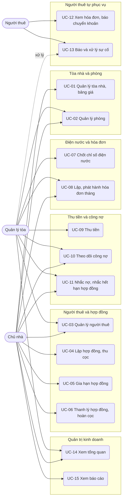

# Đặc tả use case — Quản lý Nhà trọ

> Use case phần nền (UC-SYS-01 đến UC-SYS-10): `ZDOCS/03-KIEN-TRUC/USE-CASE-NEN.md`.
> Mã FR, BR, SCR tham chiếu `02-SRS.md`.

---

## 1. Tác nhân

| Tác nhân | Mã vai trò | Use case chính |
| :--- | :--- | :--- |
| Chủ nhà | `MANAGER` | UC-01, UC-02, UC-03, UC-04, UC-05, UC-06, UC-08, UC-09 (hủy phiếu thu), UC-10, UC-11, UC-14, UC-15 |
| Quản lý tòa | `STAFF` | UC-02, UC-03, UC-07, UC-08, UC-09, UC-10, UC-11, UC-13 (xử lý), UC-14 |
| Người thuê | `TENANT` | UC-12, UC-13 (báo sự cố) |
| Quản trị viên | `ADMIN` | Toàn bộ, cộng phần nền |
| Hệ thống | — | UC-11 (nhắc nợ tự động) |

---

## 2. Sơ đồ use case

---

## 3. Danh sách use case

| Mã | Tên | Tác nhân chính | Module | Ưu tiên | FR |
| :--- | :--- | :--- | :--- | :---: | :--- |
| UC-01 | Quản lý tòa nhà và bảng giá | Chủ nhà | Tòa nhà và phòng | P1 | FR-04, FR-05 |
| UC-02 | Quản lý phòng | Chủ nhà, Quản lý tòa | Tòa nhà và phòng | P1 | FR-06, FR-07, FR-08 |
| UC-03 | Quản lý người thuê | Chủ nhà, Quản lý tòa | Người thuê và hợp đồng | P1 | FR-09, FR-15 |
| UC-04 | Lập hợp đồng và thu cọc | Chủ nhà | Người thuê và hợp đồng | P1 | FR-10, FR-11, FR-12 |
| UC-05 | Gia hạn hợp đồng | Chủ nhà | Người thuê và hợp đồng | P2 | FR-13 |
| UC-06 | Thanh lý hợp đồng và hoàn cọc | Chủ nhà | Người thuê và hợp đồng | P1 | FR-14 |
| UC-07 | Chốt chỉ số điện nước | Quản lý tòa | Điện nước và hóa đơn | P1 | FR-16, FR-17, FR-18, FR-19 |
| UC-08 | Lập và phát hành hóa đơn tháng | Quản lý tòa, Chủ nhà | Điện nước và hóa đơn | P1 | FR-20, FR-21, FR-22, FR-23, FR-24, FR-25 |
| UC-09 | Thu tiền | Quản lý tòa, Chủ nhà | Thu tiền và công nợ | P1 | FR-26, FR-27, FR-28 |
| UC-10 | Theo dõi công nợ | Chủ nhà, Quản lý tòa | Thu tiền và công nợ | P1 | FR-29, FR-30 |
| UC-11 | Nhắc nợ và nhắc hợp đồng sắp hết hạn | Chủ nhà, Quản lý tòa, Hệ thống | Thu tiền và công nợ | P2 | FR-31, FR-32, FR-33 |
| UC-12 | Xem hóa đơn và báo chuyển khoản | Người thuê | Người thuê tự phục vụ | P1 | FR-03, FR-23, FR-27 |
| UC-13 | Báo và xử lý sự cố | Người thuê, Quản lý tòa | Người thuê tự phục vụ | P2 | FR-34, FR-35 |
| UC-14 | Xem tổng quan | Chủ nhà, Quản lý tòa | Quản trị kinh doanh | P1 | FR-01, FR-02 |
| UC-15 | Xem báo cáo | Chủ nhà | Quản trị kinh doanh | P2 | FR-36, FR-37, FR-38, FR-39 |

---

## 4. Đặc tả chi tiết

### UC-01: Quản lý tòa nhà và bảng giá

| Mục | Nội dung |
| :--- | :--- |
| Tác nhân chính | Chủ nhà |
| Mô tả | Khai báo tòa nhà, tài khoản nhận tiền, đơn giá điện nước và dịch vụ theo kỳ |
| Ưu tiên | P1 |
| Điều kiện kích hoạt | Có tòa mới, đổi giá điện nước, thêm dịch vụ |
| Tiền điều kiện | Có quyền `buildings.create` hoặc `buildings.update` |
| Hậu điều kiện | Hóa đơn các kỳ từ kỳ hiệu lực dùng bảng giá mới |
| Yêu cầu liên quan | FR-04, FR-05, BR-01, BR-03 |
| Màn hình | SCR-03, SCR-04 |

**Luồng chính (đổi bảng giá)**

1. Chủ nhà mở Tòa nhà; hệ thống hiển thị danh sách tòa với số phòng, số phòng đang thuê, quản lý tòa.
2. Chọn tòa, mở tab Bảng giá và dịch vụ; hệ thống hiển thị bảng giá đang áp dụng và các bảng giá trước.
3. Bấm "Tạo bảng giá mới", chọn kỳ hiệu lực (vd 11/2026), nhập đơn giá điện, chọn cách tính nước (theo đồng hồ hoặc theo người) và đơn giá, thêm hoặc sửa dịch vụ với đơn vị tính và đơn giá.
4. Bấm "Lưu"; bảng giá mới hiện trong danh sách, ghi "Áp dụng từ kỳ 11/2026".

**Luồng thay thế**

- 1a. Thêm tòa: bấm "Thêm tòa", nhập mã, tên, địa chỉ, số tầng, chọn quản lý tòa, ngày hạn thanh toán, ngân hàng, số tài khoản, chủ tài khoản, rồi tạo bảng giá đầu tiên.
- 3a. Bảng giá có kỳ hiệu lực chưa có hóa đơn phát hành: sửa trực tiếp được.

**Luồng ngoại lệ**

- E1. Đơn giá điện, nước âm hoặc không phải bội số 100 ₫: báo lỗi tại ô nhập.
- E2. Sửa bảng giá đã dùng cho hóa đơn phát hành: các ô bị khóa, chú thích "Tạo bảng giá mới từ kỳ sau" (BR-03).
- E3. Mã tòa trùng: báo lỗi tại ô mã.

### UC-02: Quản lý phòng

| Mục | Nội dung |
| :--- | :--- |
| Tác nhân chính | Chủ nhà |
| Tác nhân phụ | Quản lý tòa (xem, chuyển đang sửa chữa) |
| Mô tả | Thêm, sửa phòng; xem sơ đồ phòng theo trạng thái |
| Ưu tiên | P1 |
| Điều kiện kích hoạt | Thêm phòng mới, đổi giá niêm yết, phòng cần sửa chữa, khách hỏi phòng trống |
| Tiền điều kiện | Có quyền `rooms.view`; thêm, sửa cần `rooms.create`, `rooms.update` |
| Hậu điều kiện | Sơ đồ phòng và tỉ lệ lấp đầy cập nhật |
| Yêu cầu liên quan | FR-06, FR-07, FR-08, BR-01, BR-02, BR-23, BR-31 |
| Màn hình | SCR-05, SCR-06 |

**Luồng chính**

1. Chủ nhà mở Sơ đồ phòng; hệ thống hiển thị từng tòa, mỗi tầng một hàng, mỗi phòng một ô: mã, giá, số người đang ở; màu xanh lá Trống, xanh dương Đang thuê, xám Đang sửa chữa; cờ đỏ nếu nợ quá hạn trên 30 ngày.
2. Chủ nhà lọc theo tòa, trạng thái, khoảng giá; đầu trang hiện số phòng theo trạng thái và tỉ lệ lấp đầy.
3. Bấm "Thêm phòng"; nhập mã, tòa, tầng, diện tích, giá niêm yết, số người tối đa, tiện nghi, tải ảnh.
4. Bấm "Lưu"; phòng hiện trên sơ đồ với trạng thái Trống.

**Luồng thay thế**

- 1a. Bấm một phòng: mở chi tiết phòng gồm thông tin, hợp đồng hiện tại, người ở, lịch sử chỉ số, hóa đơn; phòng Trống có nút "Lập hợp đồng" (UC-04).
- 4a. Sửa phòng: đổi giá niêm yết, tiện nghi; hợp đồng đang chạy giữ giá theo hợp đồng.
- 4b. Đang sửa chữa: ở phòng Trống bấm "Bắt đầu sửa chữa", nhập ghi chú; sửa xong bấm "Sửa xong" để về Trống.
- 1b. Quản lý tòa mở Sơ đồ phòng: chỉ thấy tòa được giao, không có nút Thêm, Sửa giá.

**Luồng ngoại lệ**

- E1. Mã phòng trùng: báo lỗi tại ô mã.
- E2. Chuyển phòng Đang thuê sang Đang sửa chữa: nút bị vô hiệu, chú thích "Phòng đang có hợp đồng" (BR-02).
- E3. Xóa phòng đã từng có hợp đồng: từ chối, nêu số hợp đồng liên quan.

### UC-03: Quản lý người thuê

| Mục | Nội dung |
| :--- | :--- |
| Tác nhân chính | Chủ nhà, Quản lý tòa |
| Mô tả | Lưu hồ sơ người thuê, theo dõi tạm trú, tạo tài khoản cho người thuê |
| Ưu tiên | P1 |
| Điều kiện kích hoạt | Có khách thuê mới, người ở cùng mới, cập nhật tạm trú |
| Tiền điều kiện | Có quyền `tenants.create` hoặc `tenants.update` |
| Hậu điều kiện | Người thuê sẵn sàng để gắn vào hợp đồng |
| Yêu cầu liên quan | FR-09, FR-15, BR-04, BR-29 |
| Màn hình | SCR-07 |

**Luồng chính**

1. Mở Người thuê; hệ thống hiển thị danh sách: họ tên, số điện thoại, CCCD đã che bớt, phòng đang ở, tạm trú (đã hoặc chưa đăng ký).
2. Bấm "Thêm người thuê"; nhập họ tên, số điện thoại, CCCD, ngày sinh, địa chỉ thường trú, nghề nghiệp hoặc nơi làm việc, biển số xe, tải ảnh CCCD hai mặt.
3. Bấm "Lưu"; người thuê hiện trong danh sách.

**Luồng thay thế**

- 1a. Lọc "Chưa đăng ký tạm trú" để nhắc người thuê; sau khi người thuê đăng ký trên VNeID hoặc với công an phường, đánh dấu "Đã đăng ký" và ngày đăng ký.
- 3a. Tạo tài khoản: chủ nhà bấm "Tạo tài khoản" ở người thuê đại diện; hệ thống tạo tài khoản `TENANT`, tên đăng nhập là số điện thoại, hiển thị mật khẩu tạm một lần.

**Luồng ngoại lệ**

- E1. CCCD không đủ 12 số hoặc đã có: báo lỗi tại ô CCCD.
- E2. Số điện thoại sai định dạng hoặc trùng: báo lỗi tại ô số điện thoại.
- E3. Xóa người thuê đang có tên trong hợp đồng chưa thanh lý: từ chối (BR-04).

### UC-04: Lập hợp đồng và thu cọc

| Mục | Nội dung |
| :--- | :--- |
| Tác nhân chính | Chủ nhà |
| Mô tả | Lập hợp đồng cho phòng trống, thu tiền cọc, ghi chỉ số bàn giao, in hợp đồng |
| Ưu tiên | P1 |
| Điều kiện kích hoạt | Khách đồng ý thuê phòng |
| Tiền điều kiện | Có quyền `contracts.create`; phòng đang Trống; người thuê đại diện đã có hồ sơ |
| Hậu điều kiện | Hợp đồng "Đang hiệu lực" mã `HDT…`; phòng Đang thuê; phiếu thu tiền cọc |
| Yêu cầu liên quan | FR-10, FR-11, FR-12, BR-02, BR-05, BR-06, BR-09 |
| Màn hình | SCR-09, SCR-11, SCR-06 |

**Luồng chính**

1. Chủ nhà bấm "Lập hợp đồng" ở phòng Trống (hoặc ở danh sách hợp đồng rồi chọn phòng); hệ thống điền sẵn giá thuê bằng giá niêm yết, tiền cọc bằng 1 tháng tiền thuê.
2. Chọn người thuê đại diện, thêm người ở cùng; hệ thống hiển thị số người ở trên số người tối đa.
3. Nhập ngày bắt đầu, thời hạn (mặc định 12 tháng); hệ thống tính ngày kết thúc theo BR-05.
4. Chọn dịch vụ đăng ký theo bảng giá của tòa, nhập số xe; nhập chỉ số điện, nước bàn giao.
5. Chọn phương thức thu cọc (tiền mặt, chuyển khoản), bấm "Lưu hợp đồng".
6. Hệ thống tạo hợp đồng, phiếu thu "Tiền cọc", chuyển phòng sang Đang thuê, mở bản in hợp đồng điền sẵn thông tin.

**Luồng thay thế**

- 5a. Không thu cọc: nhập tiền cọc 0 ₫; hệ thống không tạo phiếu thu cọc, hiển thị cảnh báo.
- 6a. Không in ngay: đóng bản in; in lại từ chi tiết hợp đồng.
- 2a. Người thuê chưa có hồ sơ: bấm "Thêm nhanh", nhập theo UC-03 trong hộp thoại.

**Luồng ngoại lệ**

- E1. Số người ở vượt số người tối đa của phòng: báo "Phòng tối đa 2 người", không lưu.
- E2. Tiền cọc lớn hơn 3 tháng tiền thuê: báo "Tiền cọc tối đa 9.000.000 ₫" (với giá 3.000.000 ₫).
- E3. Phòng không còn Trống (người khác vừa lập hợp đồng): báo "Phòng đã có hợp đồng", không lưu.
- E4. Ngày bắt đầu ngoài khoảng hôm nay ± 30 ngày: báo lỗi tại ô ngày.

### UC-05: Gia hạn hợp đồng

| Mục | Nội dung |
| :--- | :--- |
| Tác nhân chính | Chủ nhà |
| Mô tả | Kéo dài thời hạn hợp đồng, có thể đổi giá thuê từ một kỳ |
| Ưu tiên | P2 |
| Yêu cầu liên quan | FR-13, BR-07, BR-08 |
| Màn hình | SCR-09, SCR-16 |

**Luồng chính**

1. Chủ nhà mở hợp đồng "Sắp hết hạn" (từ Nhắc việc hoặc Tổng quan), bấm "Gia hạn".
2. Nhập số tháng gia hạn; hệ thống hiển thị ngày kết thúc mới theo BR-07.
3. Nếu đổi giá, nhập giá thuê mới và kỳ áp dụng.
4. Bấm "Lưu"; hợp đồng về "Đang hiệu lực", lịch sử gia hạn có thêm một dòng, có thể in phụ lục gia hạn.

### UC-06: Thanh lý hợp đồng và hoàn cọc

| Mục | Nội dung |
| :--- | :--- |
| Tác nhân chính | Chủ nhà |
| Mô tả | Kết thúc hợp đồng khi người thuê trả phòng: hóa đơn cuối, xử lý tiền cọc |
| Ưu tiên | P1 |
| Điều kiện kích hoạt | Người thuê báo trả phòng, hợp đồng hết hạn không gia hạn |
| Tiền điều kiện | Có quyền `contracts.terminate`; hợp đồng chưa thanh lý |
| Hậu điều kiện | Hóa đơn thanh lý; tiền cọc được cấn trừ, hoàn hoặc mất theo BR-26, BR-27; hợp đồng "Đã thanh lý"; phòng Trống |
| Yêu cầu liên quan | FR-14, BR-12, BR-13, BR-25, BR-26, BR-27 |
| Màn hình | SCR-10 |

**Luồng chính**

1. Chủ nhà mở hợp đồng, bấm "Thanh lý".
2. Nhập ngày người thuê báo trả phòng, ngày trả phòng; hệ thống cho biết có trả trước hạn không, báo trước bao nhiêu ngày, có mất cọc không (BR-26).
3. Nhập chỉ số điện, nước cuối; thêm khoản khấu trừ hư hỏng (vd "Vỡ kính cửa sổ" 150.000 ₫).
4. Hệ thống hiển thị bản xem trước: hóa đơn thanh lý từng dòng (tiền phòng theo số ngày ở, điện, nước, dịch vụ, khấu trừ, khoản phát sinh chờ), nợ cũ, tiền cọc, số mất cọc, cấn trừ, số hoàn cọc hoặc số còn phải thu.
5. Chủ nhà bấm "Xác nhận thanh lý".
6. Hệ thống phát hành hóa đơn thanh lý, ghi cấn trừ cọc, lập phiếu chi hoàn cọc nếu còn dư, chuyển hợp đồng "Đã thanh lý", phòng Trống.

**Luồng thay thế**

- 4a. Cọc không đủ bù hóa đơn và nợ cũ: hệ thống hiển thị "Người thuê còn phải trả X ₫"; sau khi xác nhận, phần còn nợ theo dõi ở Công nợ.
- 4b. Mất cọc: dòng "Mất cọc" hiện số tiền mất; cọc không được cấn trừ; hóa đơn thanh lý ở trạng thái "Chưa thanh toán".
- 2a. Hợp đồng đã hết hạn, trả phòng đúng ngày kết thúc: không xét mất cọc.

**Luồng ngoại lệ**

- E1. Hóa đơn tháng của kỳ chứa ngày trả phòng đã phát hành: từ chối, báo "Hủy hóa đơn HD2610-A203 trước khi thanh lý" (BR-25).
- E2. Chỉ số cuối nhỏ hơn chỉ số cũ: báo lỗi tại ô chỉ số.
- E3. Ngày trả phòng trước ngày bắt đầu hợp đồng hoặc sau hôm nay + 30 ngày: báo lỗi tại ô ngày.

### UC-07: Chốt chỉ số điện nước

| Mục | Nội dung |
| :--- | :--- |
| Tác nhân chính | Quản lý tòa |
| Mô tả | Đi từng phòng ghi chỉ số công tơ điện, đồng hồ nước của kỳ |
| Ưu tiên | P1 |
| Điều kiện kích hoạt | Ngày cuối tháng |
| Tiền điều kiện | Có quyền `meter-readings.create`; được giao tòa |
| Hậu điều kiện | Phòng được đánh dấu "Đã chốt" cho kỳ; sẵn sàng lập hóa đơn |
| Yêu cầu liên quan | FR-16 đến FR-19, BR-09, BR-10, BR-11 |
| Màn hình | SCR-12 |

**Luồng chính**

1. Quản lý tòa mở Chốt điện nước trên điện thoại; hệ thống chọn sẵn tòa được giao và kỳ hiện tại, hiển thị tiến độ (vd "0/16 phòng").
2. Chọn phòng đầu tiên chưa chốt; hệ thống hiển thị chỉ số điện cũ, nước cũ (BR-09) và trung bình tiêu thụ 3 kỳ.
3. Nhập chỉ số điện mới, nước mới; hệ thống hiện ngay tiêu thụ (vd "138 kWh", "11 m³").
4. Chụp ảnh công tơ (tùy chọn), bấm "Lưu và tiếp"; phòng đánh dấu "Đã chốt", màn chuyển sang phòng kế.
5. Lặp tới khi hết phòng; tiến độ đủ thì hiện nút "Lập hóa đơn kỳ này" (UC-08).

**Luồng thay thế**

- 3a. Tiêu thụ bất thường: hệ thống hiện cảnh báo vàng "Gấp 3,0 lần trung bình 3 kỳ (150 kWh)"; quản lý tòa kiểm tra lại, bấm "Vẫn lưu"; chỉ số gắn cờ "Bất thường" (BR-10).
- 2a. Phòng có hợp đồng mới bắt đầu trong kỳ: chỉ số cũ là chỉ số bàn giao.
- 2b. Sửa chỉ số đã chốt khi hóa đơn kỳ đó còn nháp: chọn phòng, sửa, lưu; hóa đơn nháp tự tính lại.
- 3b. Thay công tơ giữa kỳ (P3): bấm "Thay công tơ", nhập chỉ số cuối công tơ cũ và chỉ số đầu công tơ mới.

**Luồng ngoại lệ**

- E1. Chỉ số mới nhỏ hơn chỉ số cũ: báo "Chỉ số mới phải từ 1.645 trở lên", không lưu.
- E2. Sửa chỉ số khi hóa đơn kỳ đó đã phát hành: ô bị khóa, chú thích "Hủy hóa đơn trước khi sửa" (BR-11).
- E3. Mất kết nối khi lưu (chế độ `api`): giữ số đã nhập trên máy, báo lỗi, cho thử lại.

### UC-08: Lập và phát hành hóa đơn tháng

| Mục | Nội dung |
| :--- | :--- |
| Tác nhân chính | Quản lý tòa |
| Tác nhân phụ | Chủ nhà (hủy hóa đơn đã phát hành) |
| Mô tả | Lập hóa đơn hàng loạt cho tòa và kỳ, kiểm tra, thêm khoản phát sinh, phát hành |
| Ưu tiên | P1 |
| Điều kiện kích hoạt | Đã chốt chỉ số kỳ |
| Tiền điều kiện | Có quyền `invoices.create`, `invoices.issue` |
| Hậu điều kiện | Hóa đơn "Chưa thanh toán" mã `HD{yyMM}-{mã phòng}`, hiện ở trang người thuê kèm QR |
| Yêu cầu liên quan | FR-20 đến FR-25, BR-12 đến BR-19 |
| Màn hình | SCR-13, SCR-14 |

**Luồng chính**

1. Quản lý tòa mở Hóa đơn, bấm "Lập hóa đơn", chọn tòa và kỳ.
2. Hệ thống lập hóa đơn nháp cho mọi hợp đồng hiệu lực trong kỳ đã chốt chỉ số; báo kết quả "Đã lập N hóa đơn, bỏ qua M phòng" kèm danh sách phòng bỏ qua và lý do (BR-15).
3. Hệ thống hiển thị danh sách nháp: phòng, người thuê, tiền phòng, điện, nước, dịch vụ, phát sinh, tổng.
4. Quản lý tòa mở một hóa đơn để kiểm tra từng dòng: tiền phòng (ghi số ngày ở nếu không đủ tháng), điện (cũ, mới, tiêu thụ × đơn giá), nước, từng dịch vụ, khoản phát sinh chờ, nợ kỳ trước, tổng cần thanh toán.
5. Tick các hóa đơn, bấm "Phát hành"; hệ thống chuyển "Chưa thanh toán", tính hạn theo BR-16, gửi thông báo tới trang người thuê.

**Luồng thay thế**

- 4a. Thêm khoản phát sinh hoặc giảm trừ vào hóa đơn nháp (vd "Thay bóng đèn" 50.000 ₫); tổng tính lại ngay.
- 4b. Xóa hóa đơn nháp để lập lại sau khi sửa chỉ số.
- 5a. Gửi qua Zalo (giả lập): bấm "Sao chép tin nhắn"; hệ thống chép nội dung tóm tắt kèm đường dẫn hóa đơn.
- 5b. In hóa đơn khổ A5.
- 5c. Chủ nhà hủy hóa đơn đã phát hành chưa có thanh toán: bấm "Hủy", nhập lý do; hóa đơn "Đã hủy", lập lại được cho kỳ đó.

**Luồng ngoại lệ**

- E1. Phòng chưa chốt chỉ số: bị bỏ qua với lý do "Chưa chốt chỉ số kỳ 10/2026".
- E2. Hợp đồng đã có hóa đơn kỳ đó: bị bỏ qua với lý do "Đã có hóa đơn HD2610-A203".
- E3. Hủy hóa đơn đã có phiếu thu: nút "Hủy" bị vô hiệu, chú thích "Hủy phiếu thu trước" (BR-18).

### UC-09: Thu tiền

| Mục | Nội dung |
| :--- | :--- |
| Tác nhân chính | Quản lý tòa |
| Tác nhân phụ | Chủ nhà (hủy phiếu thu), Người thuê (báo chuyển khoản) |
| Mô tả | Ghi nhận tiền người thuê trả, phân bổ vào hóa đơn, in phiếu thu |
| Ưu tiên | P1 |
| Điều kiện kích hoạt | Người thuê trả tiền mặt, chuyển khoản, hoặc báo đã chuyển khoản |
| Tiền điều kiện | Có quyền `payments.create`; phòng có hóa đơn còn nợ |
| Hậu điều kiện | Phiếu thu mã `PT…`; hóa đơn cập nhật trạng thái theo BR-17; công nợ giảm |
| Yêu cầu liên quan | FR-26, FR-27, FR-28, BR-17, BR-20, BR-21, BR-22 |
| Màn hình | SCR-15, SCR-14 |

**Luồng chính**

1. Quản lý tòa mở Thu tiền, chọn phòng (hoặc bấm "Thu tiền" ở hóa đơn); hệ thống hiển thị các hóa đơn còn nợ theo hạn và tổng nợ.
2. Chọn phương thức, nhập số tiền (mặc định bằng tổng nợ), ngày thu, ghi chú.
3. Hệ thống hiển thị trước cách phân bổ vào từng hóa đơn theo BR-20.
4. Bấm "Lưu"; hệ thống tạo phiếu thu, cập nhật hóa đơn, mở bản in phiếu thu.

**Luồng thay thế**

- 1a. Xác nhận chuyển khoản: tab "Chờ xác nhận chuyển khoản" liệt kê báo chuyển khoản của người thuê kèm ảnh biên lai; quản lý tòa đối chiếu tài khoản ngân hàng, bấm "Xác nhận" (tạo phiếu thu chuyển khoản) hoặc "Từ chối" kèm lý do (BR-22).
- 2a. Thu theo một hóa đơn cụ thể: chọn hóa đơn; số tiền tối đa bằng số còn nợ của hóa đơn đó.
- 4a. Chủ nhà hủy phiếu thu: chọn phiếu, bấm "Hủy", nhập lý do; hóa đơn trở về trạng thái nợ tương ứng (BR-21).

**Luồng ngoại lệ**

- E1. Số tiền lớn hơn tổng nợ: báo "Vượt số còn nợ 2.123.000 ₫", không lưu.
- E2. Số tiền bằng 0 hoặc để trống: nút "Lưu" bị khóa.
- E3. Quản lý tòa không có nút "Hủy" phiếu thu.

### UC-10: Theo dõi công nợ

| Mục | Nội dung |
| :--- | :--- |
| Tác nhân chính | Chủ nhà |
| Tác nhân phụ | Quản lý tòa (tòa được giao) |
| Mô tả | Biết phòng nào còn nợ, nợ bao lâu, tiền cọc đang giữ |
| Ưu tiên | P1 |
| Tiền điều kiện | Có quyền `payments.view` |
| Hậu điều kiện | Không thay đổi dữ liệu |
| Yêu cầu liên quan | FR-29, FR-30, BR-17, BR-23, BR-29 |
| Màn hình | SCR-15, SCR-05 |

**Luồng chính**

1. Chủ nhà mở Thu tiền, tab Công nợ; hệ thống hiển thị thẻ tổng nợ theo nhóm tuổi nợ (BR-23) và danh sách phòng còn nợ: phòng, người thuê, số hóa đơn nợ, tổng nợ, số ngày quá hạn lâu nhất.
2. Lọc theo tòa, nhóm tuổi nợ; sắp xếp theo tổng nợ hoặc số ngày quá hạn.
3. Bấm một phòng: xem từng hóa đơn nợ, lịch sử thu, lịch sử nhắc nợ; có nút "Thu tiền" (UC-09) và "Nhắc nợ" (UC-11).

**Luồng thay thế**

- 1a. Tab Tiền cọc: tổng cọc đang giữ theo tòa, chi tiết từng hợp đồng (thu, cấn trừ, mất cọc, hoàn).
- 1b. Quản lý tòa chỉ thấy phòng của tòa được giao.

**Luồng ngoại lệ**

- E1. Không có phòng nào còn nợ: hiển thị trạng thái trống "Tất cả phòng đã thanh toán".

### UC-11: Nhắc nợ và nhắc hợp đồng sắp hết hạn

| Mục | Nội dung |
| :--- | :--- |
| Tác nhân chính | Chủ nhà, Quản lý tòa, Hệ thống |
| Mô tả | Gửi nhắc nợ (giả lập Zalo, SMS), theo dõi hợp đồng sắp hết hạn |
| Ưu tiên | P2 |
| Yêu cầu liên quan | FR-31, FR-32, FR-33, BR-08, BR-24 |
| Màn hình | SCR-16 |

**Luồng chính**

1. Chủ nhà mở Nhắc việc, tab Nhắc nợ; hệ thống liệt kê hóa đơn sắp tới hạn trong 2 ngày và hóa đơn quá hạn, lần nhắc gần nhất.
2. Tick một hoặc nhiều phòng, bấm "Gửi nhắc"; hệ thống hiển thị nội dung mẫu đã điền (vd "Phòng A305 – Nhà trọ Bình An: còn nợ 5.400.000 ₫ gồm HD2608-A305 1.500.000 ₫, HD2609-A305 3.900.000 ₫. Chuyển khoản: …, nội dung A305").
3. Sửa nội dung nếu cần, chọn kênh Zalo hoặc SMS, bấm "Gửi"; hệ thống lưu lịch sử, hiện thông báo ở trang người thuê, ghi "Đã gửi (giả lập)".
4. Tab Hợp đồng sắp hết hạn: danh sách hợp đồng hết hạn trong 30 ngày và quá hạn, có nút "Gia hạn" (UC-05) và "Thanh lý" (UC-06).

### UC-12: Xem hóa đơn và báo chuyển khoản

| Mục | Nội dung |
| :--- | :--- |
| Tác nhân chính | Người thuê |
| Mô tả | Người thuê xem hóa đơn trên điện thoại, quét QR chuyển khoản, báo đã chuyển |
| Ưu tiên | P1 |
| Điều kiện kích hoạt | Nhận thông báo hóa đơn mới hoặc nhắc nợ |
| Tiền điều kiện | Đăng nhập tài khoản `TENANT` gắn hợp đồng đang hiệu lực |
| Hậu điều kiện | Báo chuyển khoản "Chờ xác nhận" (nếu người thuê báo) |
| Yêu cầu liên quan | FR-03, FR-23, FR-27, BR-19, BR-22, BR-29 |
| Màn hình | SCR-02, SCR-14 |

**Luồng chính**

1. Người thuê đăng nhập; hệ thống mở trang người thuê: phòng, tòa, ngày hết hạn hợp đồng, tiền cọc, thẻ "Hóa đơn cần thanh toán" với tổng tiền và hạn.
2. Bấm thẻ hóa đơn; hệ thống hiển thị từng dòng: tiền phòng, điện (cũ, mới, tiêu thụ, đơn giá), nước, dịch vụ, phát sinh, tổng, đã trả, còn nợ.
3. Bấm "Chuyển khoản"; hệ thống hiển thị QR có số tiền còn nợ và nội dung là mã hóa đơn, kèm tên ngân hàng, số tài khoản để sao chép.
4. Sau khi chuyển, người thuê bấm "Tôi đã chuyển khoản", nhập số tiền (mặc định số còn nợ), đính ảnh biên lai, gửi.
5. Hóa đơn hiện nhãn "Chờ xác nhận"; quản lý tòa nhận thông báo (UC-09 luồng 1a).

**Luồng thay thế**

- 1a. Xem lịch sử: danh sách hóa đơn các kỳ và phiếu thu đã ghi nhận.
- 1b. Xem thông báo nhắc nợ, thông báo từ chối báo chuyển khoản kèm lý do.
- 1c. Bấm "Báo sự cố": chuyển sang UC-13.

**Luồng ngoại lệ**

- E1. Mở hóa đơn, hợp đồng của phòng khác qua URL: chuyển tới `/forbidden` (BR-29).
- E2. Hóa đơn đã có báo chuyển khoản đang chờ xác nhận: nút "Tôi đã chuyển khoản" bị vô hiệu, ghi "Đang chờ quản lý xác nhận".
- E3. Truy cập trang quản lý (`/rooms`, `/invoices` danh sách): chuyển tới `/forbidden`.

### UC-13: Báo và xử lý sự cố

| Mục | Nội dung |
| :--- | :--- |
| Tác nhân chính | Người thuê |
| Tác nhân phụ | Quản lý tòa |
| Mô tả | Người thuê báo hỏng hóc, quản lý tòa xử lý và ghi chi phí |
| Ưu tiên | P2 |
| Yêu cầu liên quan | FR-34, FR-35, BR-28 |
| Màn hình | SCR-17, SCR-02 |

**Luồng chính**

1. Người thuê bấm "Báo sự cố", chọn loại, mức (Thường, Khẩn cấp), nhập mô tả, chụp ảnh, gửi; hệ thống tạo sự cố mã `SC…` trạng thái "Mới", báo quản lý tòa.
2. Quản lý tòa mở Sự cố, bấm "Tiếp nhận"; trạng thái "Đang xử lý". Quá 2 giờ (khẩn cấp) hoặc 24 giờ (thường) chưa tiếp nhận thì sự cố có nhãn đỏ.
3. Xử lý xong, quản lý tòa nhập kết quả, chi phí, bên chịu (chủ nhà hoặc người thuê); trạng thái "Đã xử lý". Chi phí người thuê chịu thành khoản phát sinh chờ của hợp đồng.
4. Người thuê bấm "Đã xong" để đóng, hoặc "Chưa xong" để mở lại; sau 3 ngày không phản hồi hệ thống tự đóng.

### UC-14: Xem tổng quan

| Mục | Nội dung |
| :--- | :--- |
| Tác nhân chính | Chủ nhà |
| Tác nhân phụ | Quản lý tòa (tòa được giao) |
| Mô tả | Nắm nhanh tình trạng phòng, tiền thu kỳ này và việc cần làm |
| Ưu tiên | P1 |
| Tiền điều kiện | Có quyền `dashboard.view` |
| Hậu điều kiện | Không thay đổi dữ liệu |
| Yêu cầu liên quan | FR-01, FR-02, BR-08, BR-17, BR-29, BR-31 |
| Màn hình | SCR-01 |

**Luồng chính**

1. Chủ nhà đăng nhập; hệ thống mở Tổng quan.
2. Hiển thị thẻ số: phòng đang thuê, trống, đang sửa chữa, tỉ lệ lấp đầy (BR-31); tiền hóa đơn kỳ này, đã thu, còn nợ; số hóa đơn quá hạn.
3. Hiển thị danh sách việc cần làm: phòng chưa chốt điện nước kỳ này, hợp đồng hết hạn trong 30 ngày, hóa đơn quá hạn trên 30 ngày, sự cố đang mở, báo chuyển khoản chờ xác nhận.
4. Bấm một mục: chuyển tới màn tương ứng, lọc sẵn.

**Luồng thay thế**

- 1a. Chọn tòa ở đầu trang: số liệu chỉ của tòa đó.
- 1b. Quản lý tòa: chỉ thấy số liệu và việc của tòa được giao.

**Luồng ngoại lệ**

- E1. Kỳ này chưa có hóa đơn: thẻ tiền hiển thị 0 ₫ kèm gợi ý "Chốt điện nước để lập hóa đơn".

### UC-15: Xem báo cáo

| Mục | Nội dung |
| :--- | :--- |
| Tác nhân chính | Chủ nhà |
| Mô tả | Xem doanh thu, tỉ lệ lấp đầy, tiền cọc, điện nước theo thời gian |
| Ưu tiên | P2 |
| Yêu cầu liên quan | FR-36 đến FR-39, BR-31 |
| Màn hình | SCR-18 |

**Luồng chính**

1. Chủ nhà mở Báo cáo; mặc định tab Doanh thu, 6 kỳ gần nhất, tất cả tòa.
2. Hệ thống hiển thị biểu đồ cột chồng theo kỳ (tiền phòng, điện, nước, dịch vụ, phát sinh) và đường thực thu, bảng số liệu bên dưới.
3. Chuyển tab Tỉ lệ lấp đầy, Tiền cọc, Điện nước; đổi khoảng kỳ, tòa; bấm "Xuất Excel" để tải báo cáo đang xem (P3).
